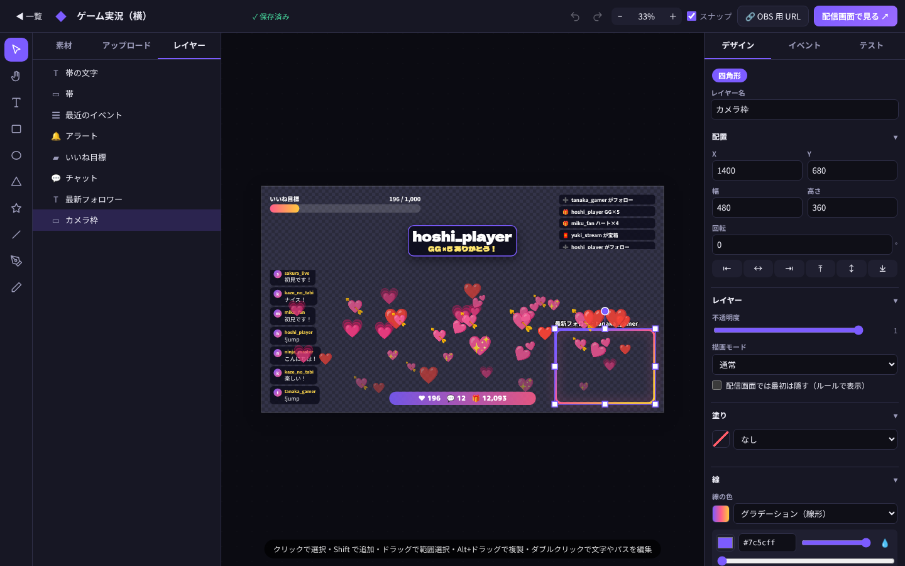
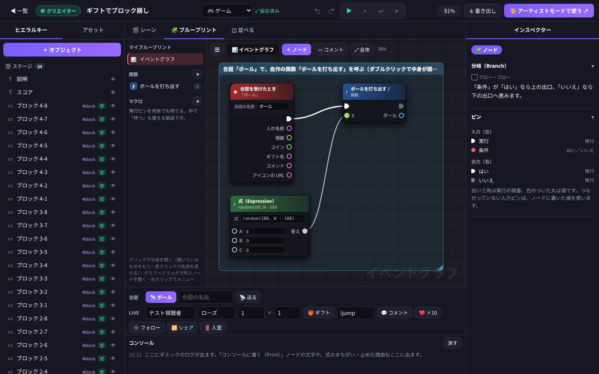
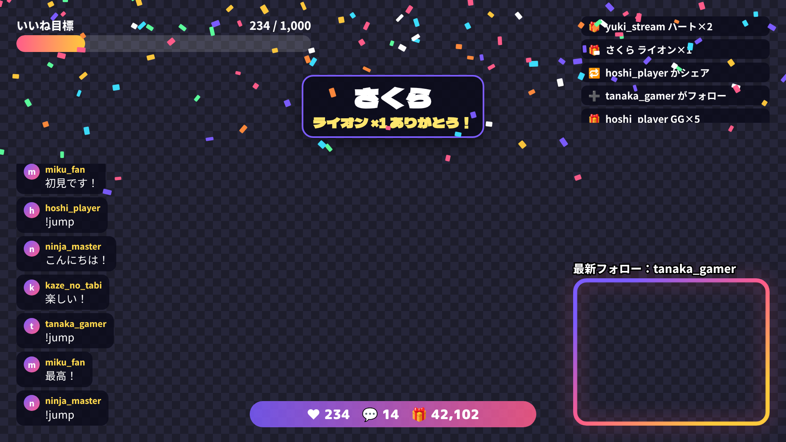
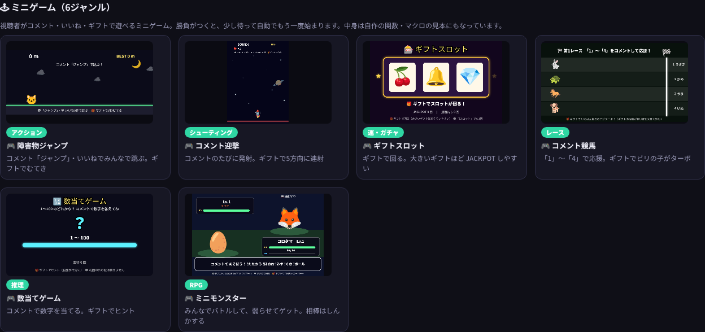

# LiveDesign — 設計ドキュメント

> **配信画面をデザインして、TikTok LIVE のギフトとコメントで動かす Web サービス。**
> Canva のようなデザインエディタと、Unreal Engine のブループリントのようなノード式ゲームエディタを、
> フレームワークを使わない素の JavaScript と Node.js で実装した。

<table>
<tr>
<td width="50%"></td>
<td width="50%"></td>
</tr>
<tr>
<td align="center">アーティストモード（デザインエディタ）</td>
<td align="center">クリエイターモード（ブループリント）</td>
</tr>
<tr>
<td width="50%"></td>
<td width="50%"></td>
</tr>
<tr>
<td align="center">OBS に映る画面（ギフトでアラートと紙吹雪）</td>
<td align="center">視聴者参加型ミニゲーム 6 ジャンル</td>
</tr>
</table>

## プロジェクト概要

| 項目 | 内容 |
|---|---|
| 種別 | Web サービス（マルチユーザー・会員登録制）／個人開発 |
| 利用環境 | PC ブラウザ＋OBS / TikTok LIVE Studio |
| 担当 | 企画・設計・フロントエンド・バックエンド・インフラ・テストすべて 1 人 |
| 規模 | サーバー 約 3,400 行 ／ ブラウザ JS 約 16,200 行 ／ CSS・HTML 約 1,900 行 ／ テスト 約 2,600 行（687 件） |
| 依存ライブラリ | 本番は 4 つだけ（`express`・`ws`・`dotenv`・`tiktok-live-connector`） |

### 技術スタック

| 分類 | 技術 |
|---|---|
| バックエンド | Node.js 22（ES Modules）、Express 5、`ws`（WebSocket）、`node:sqlite`（Node 標準の SQLite） |
| フロントエンド | 素の JavaScript（ES Modules）、DOM、Canvas、Web Audio（効果音シンセ）、Speech Synthesis（読み上げ） |
| 認証 | scrypt、セッション Cookie、Google / TikTok OAuth 2.0、API キー |
| 外部連携 | TikTok LIVE（`tiktok-live-connector` ＋ Euler Stream の署名 API） |
| インフラ | Docker、Caddy（HTTPS 自動化） |
| テスト | 自作の軽量テストランナー（別プロセス実行）、本物のサーバーを立てる結合テスト |

---

## このプロジェクトで伝えたいこと

### 1. ノード式ビジュアルプログラミング環境を一から作った

Unreal Engine の Blueprint にならい、**ノードを線でつなぐだけでゲームが作れる実行環境**を実装しました。

- 実行ピン（順番）とデータピン（値）を区別したグラフの実行器、型の自動変換
- 分岐・繰り返し・待つ・一度だけ・交互に・クールダウンなどのフロー制御
- **自作の関数とマクロ**（ピュア関数・出口が複数のマクロ・選んだノードを関数にまとめるリファクタリング）
- 物理・当たり判定・パーティクル・効果音シンセ（音声ファイルなしで波形を合成）
- 実行中に**動いたノードが光る**デバッグ表示と、コンソール

その上に、ブロック崩し・スロット・競馬・数当て・RPG など**ミニゲーム 6 ジャンルをテンプレートとして実装**し、テストで実際に遊ばせて動作を確認しています。

### 2. 「人からもらった JSON」を安全に実行する

ギミックは JSON で配布できるため、悪意のあるデータを読み込まれる前提で設計しました。

- 式は**自前のパーサで解釈し、`eval` / `Function` を一切使わない**（`constructor` も辿れない）。この決まりは構造テストが見張る
- 無限ループ・合図の連鎖・計算ノードの循環・再帰（16 段）を検出して止め、理由をコンソールに出す。**作りの悪いギミックでも配信は止まらない**
- 保存前に形・数・文字数・色や URL を検査し、`__proto__` などのキーを捨てる

### 3. Web サービスとしてのセキュリティを一通り実装した

CSRF（Origin 検査）、XSS（CSP・視聴者の文字はテキストとして描画）、総当たり（回数制限と応答時間の均一化）、セッション（HttpOnly Cookie・DB にはハッシュだけ）、オープンリダイレクト、クリックジャッキング、OAuth でのアカウント乗っ取り対策まで実装しました。認証は**用途ごとに 3 種類**（ログイン Cookie／OBS 用の URL の合鍵／外部ツール用の API キー）に分け、**API キーが漏れてもアカウントは乗っ取られない**ようにしています（→ [設計書 6 章](design.md#6-セキュリティ設計)）。

### 4. リアルタイム配信を少ないリソースで回す

- TikTok には**画面を開いている間だけ**接続し、**同じ @ID の接続は 1 本を共有**
- 利用者ごとの作業場は使っている人の分だけメモリに置き、カウンターはまとめて書き出す
- デザインを保存すると、**OBS の画面がその場で描き直される**（配信を止めずに見た目を直せる）
- SIGTERM で受付停止 → 画面に通知 → カウンター書き出し → DB を閉じる、の順に安全に終了

### 5. 設計の決まりをテストで守る

依存の向き（`config → net → db → auth → …`）、公開範囲（`public/` だけ）、ログインの付け忘れ、環境変数の置き場所といった**設計のルールそのものを `structure.test.mjs` で検査**しています。結合テストは本物のサーバーを空きポートで立て、HTTP と WebSocket を通して「他人のデータが見えない」ことまで確かめます。**687 件すべて成功**（Node.js 22.22 で実行）。

---

## 技術的な課題と解決

| 課題 | 解決 |
|---|---|
| 同じ配信者を複数の利用者（本人・モデレーター）が読むと接続が増える | @ID ごとの room に subscribers をぶら下げ、接続を 1 本に共有 |
| 配信がまだ始まっていない @ID への接続 | 間隔を広げながら待って繋ぎ直す。画面から「今すぐ繋ぐ」も可能 |
| ギフトの連打で同じギフトが何度も届く | 連打の途中は数えず、確定（repeatEnd）で合計して判定 |
| 全角の `！ｊｕｍｐ` や半角カナのコメント | コマンド判定の前に正規化し、日本語入力のままでも反応させる。`!jumpman` は `!jump` と区別 |
| いいねが塊で届く | 「N 件ごと」の区切りを跨いだ回数ぶん発火 |
| エディタと配信画面で動きがずれる | 描画・実行部品（`shared/`）を両方で共有。ギミックエンジンは DOM 非依存にして Node のテストでも同じコードを動かす |
| 依存を増やすと供給網のリスクと運用コストが増える | フレームワークなし・本番依存 4 つ。DB も Node 標準の SQLite |

---

## ドキュメント一覧

| ドキュメント | 内容 |
|---|---|
| [要件定義書](requirements.md) | 背景・目的・対象ユーザー・機能要件・非機能要件・公開前に決めること |
| [画面定義書](screen-definitions.md) | ページと画面の一覧、各画面の表示項目／操作／入力チェック |
| [設計書](design.md) | システム構成・モジュール構成・データモデル・シーケンス図・DB・セキュリティ・運用 |
| [API 仕様書](api.md) | REST API（認証・アカウント・スタジオ・素材・接続）と WebSocket メッセージ |
| [テスト仕様・結果](test-report.md) | テスト方針・687 件の内訳と実行結果・代表ケース |
| [diagrams/](diagrams/) | PlantUML ソース（`src/`）と SVG（`svg/`） |
| [screenshots/](screenshots/) | 主要画面のスクリーンショット |

### 図の一覧

| 図 | PlantUML | SVG |
|---|---|---|
| ユースケース図 | [usecase.puml](diagrams/src/usecase.puml) | [usecase.svg](diagrams/svg/usecase.svg) |
| システム構成図 | [architecture.puml](diagrams/src/architecture.puml) | [architecture.svg](diagrams/svg/architecture.svg) |
| モジュール構成図（サーバー） | [module-server.puml](diagrams/src/module-server.puml) | [module-server.svg](diagrams/svg/module-server.svg) |
| モジュール構成図（ブラウザ） | [module-client.puml](diagrams/src/module-client.puml) | [module-client.svg](diagrams/svg/module-client.svg) |
| クラス図（データモデル） | [class-model.puml](diagrams/src/class-model.puml) | [class-model.svg](diagrams/svg/class-model.svg) |
| シーケンス図① イベント処理 | [seq-live-event.puml](diagrams/src/seq-live-event.puml) | [seq-live-event.svg](diagrams/svg/seq-live-event.svg) |
| シーケンス図② 認証 | [seq-auth.puml](diagrams/src/seq-auth.puml) | [seq-auth.svg](diagrams/svg/seq-auth.svg) |
| シーケンス図③ 保存と即時反映 | [seq-save-scene.puml](diagrams/src/seq-save-scene.puml) | [seq-save-scene.svg](diagrams/svg/seq-save-scene.svg) |
| シーケンス図④ ブループリント実行 | [seq-gimmick.puml](diagrams/src/seq-gimmick.puml) | [seq-gimmick.svg](diagrams/svg/seq-gimmick.svg) |
| 画面遷移図 | [screen-transition.puml](diagrams/src/screen-transition.puml) | [screen-transition.svg](diagrams/svg/screen-transition.svg) |
| ER 図 | [er.puml](diagrams/src/er.puml) | [er.svg](diagrams/svg/er.svg) |

SVG の再生成：

```bash
cd Doc/diagrams/src
java -jar plantuml.jar -charset UTF-8 -tsvg -o ../svg *.puml
```
