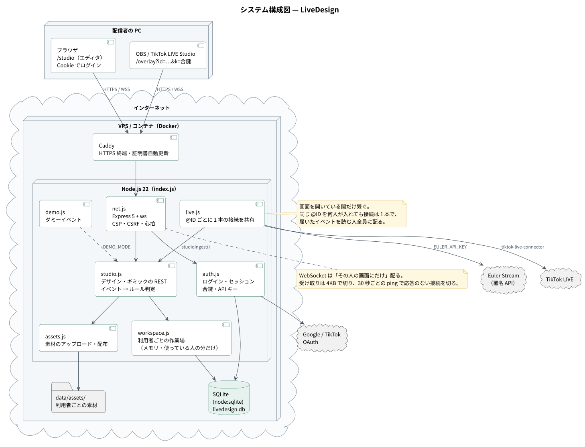
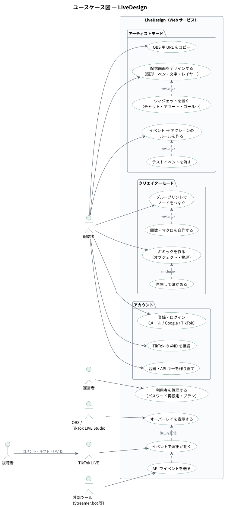
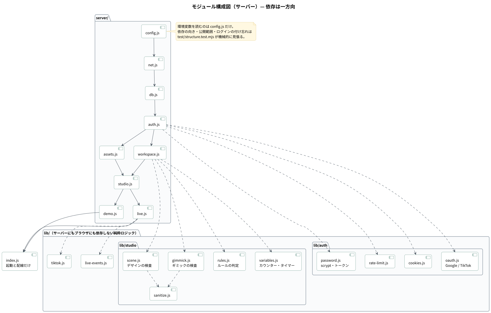
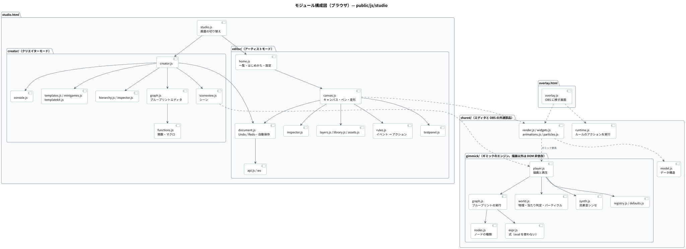
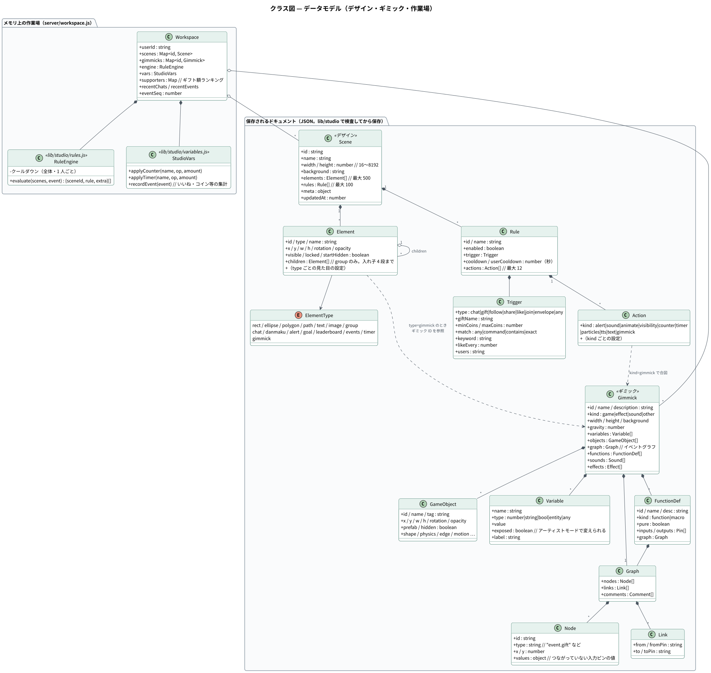
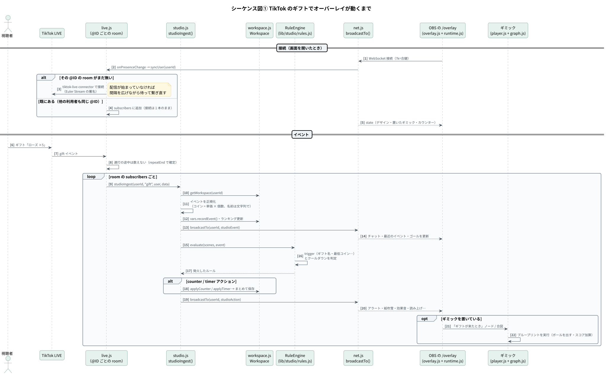
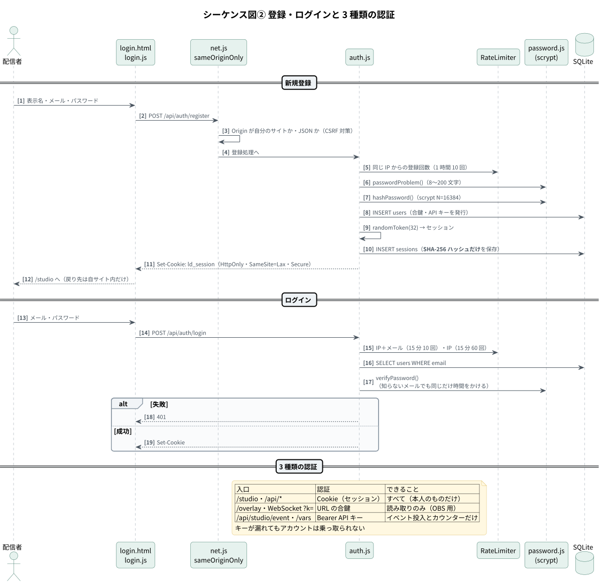
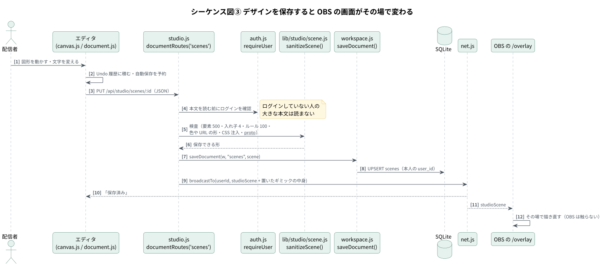
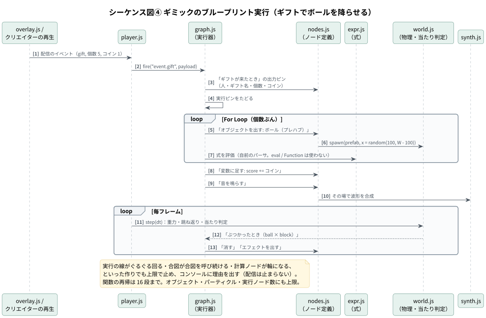
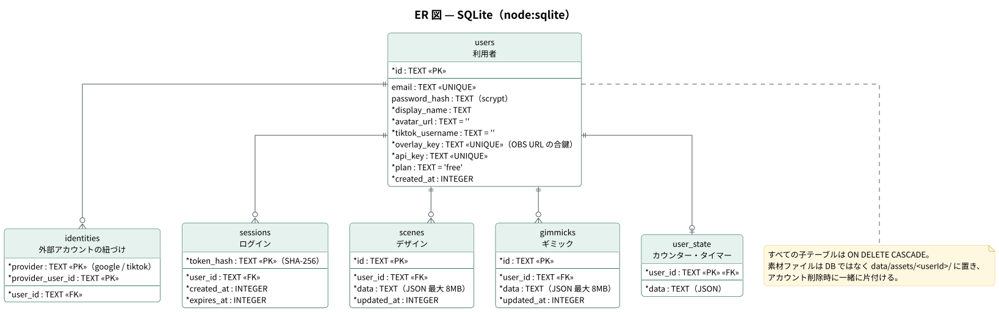

# 設計書 — LiveDesign

1. [システム構成](#1-システム構成)
2. [モジュール構成](#2-モジュール構成)
3. [クラス図（データモデル）](#3-クラス図データモデル)
4. [シーケンス図](#4-シーケンス図)
5. [データベース設計](#5-データベース設計)
6. [セキュリティ設計](#6-セキュリティ設計)
7. [運用設計](#7-運用設計)
8. [ディレクトリ構成](#8-ディレクトリ構成)

API の詳細は [API 仕様書](api.md) を参照してください。図の PlantUML ソースは [`diagrams/src/`](diagrams/src/)、SVG は [`diagrams/svg/`](diagrams/svg/) にあります。

---

## 1. システム構成



| 要素 | 技術 | 役割 |
|---|---|---|
| Web サーバー | Node.js 22 / Express 5 | ページ・REST API・静的ファイル |
| リアルタイム配信 | `ws`（WebSocket） | イベント・アクション・保存の通知を「その人の画面にだけ」配る |
| データベース | `node:sqlite`（Node 標準の SQLite） | 利用者・セッション・デザイン・ギミック・カウンター |
| 素材 | ファイルシステム（`data/assets/<userId>/`） | 画像・音・動画 |
| TikTok LIVE | `tiktok-live-connector` ＋ Euler Stream の署名 API | @ID ごとに 1 本の接続を複数の利用者で共有 |
| ログイン | メール＋パスワード（scrypt）、Google / TikTok OAuth | |
| フロントエンド | 素の JavaScript（ES Modules）・Canvas・Web Audio・Speech Synthesis | フレームワークを使わない |
| 配置 | Docker ＋ Caddy（HTTPS 自動化） | |

### ユースケース



### 設計の要点

| 要点 | 内容 |
|---|---|
| 必要なときだけ繋ぐ | TikTok には、その人のスタジオか OBS の画面が開いている間だけ接続する（`onPresenceChange` → `syncUser`）。閉じても猶予を置いてから切る |
| 接続を共有する | 同じ @ID を何人が入れても接続は 1 本（room）。届いたイベントを subscribers 全員に配る |
| 作業場はメモリに | 使っている人の分だけ `Workspace` をメモリに置き、10 分誰も見ていなければ外す。カウンターは 5 秒ごとにまとめて書き出す |
| 止め方 | SIGTERM で受付をやめ、画面に通知し、カウンターを書き出して DB を閉じる（5 秒で打ち切り。docker stop の 10 秒に間に合わせる） |

---

## 2. モジュール構成

### サーバー



依存は `config → net → db → auth → workspace / assets → studio → live / demo → index` の**一方向**です。環境変数を読むのは `config.js` だけ、純粋ロジックは `lib/` に分けてサーバーにもブラウザにも依存させていません。この決まりは `test/structure.test.mjs` が機械的に見張っています。

### ブラウザ



エディタと OBS の画面は `shared/` の描画・実行部品を共有しているため、**エディタで見た動きと配信画面の動きが一致**します。ギミックのエンジン（`shared/gimmick/`）は描画以外 DOM に触らないので、Node 上のテストでもそのまま動きます。

---

## 3. クラス図（データモデル）



デザイン（Scene）とギミック（Gimmick）は JSON ドキュメントとして保存し、保存前に `lib/studio/scene.js` / `gimmick.js` で**形・数・文字数・色や URL の形**を検査して、保存できる形に整えます（本文の `id` は信用せず、保存先の ID で上書き）。

| 上限 | デザイン | ギミック |
|---|---|---|
| 本文 | 8MB | 8MB |
| 要素・オブジェクト | 500（グループの中を含む）・入れ子 4 段 | 上限あり（`GIMMICK_LIMITS`） |
| ルール・ノード | ルール 100・アクション 12 / ルール | ノード・リンク・関数の総ノード数に上限 |
| キャンバス | 一辺 8192px | |

---

## 4. シーケンス図

### 4-1. TikTok のギフトでオーバーレイが動くまで



### 4-2. 登録・ログインと 3 種類の認証



### 4-3. デザインを保存すると OBS の画面がその場で変わる



### 4-4. ギミックのブループリント実行



---

## 5. データベース設計



| 表 | 主な列 | 説明 |
|---|---|---|
| `users` | `id`, `email`(UNIQUE), `password_hash`, `display_name`, `tiktok_username`, `overlay_key`(UNIQUE), `api_key`(UNIQUE), `plan`, `created_at` | 利用者。パスワードは scrypt ハッシュ |
| `identities` | (`provider`, `provider_user_id`) PK, `user_id` | Google / TikTok アカウントとの紐づけ |
| `sessions` | `token_hash` PK, `user_id`, `created_at`, `expires_at` | トークンそのものではなく **SHA-256 ハッシュだけ**を保存 |
| `scenes` | `id` PK, `user_id`, `data`(JSON), `updated_at` | デザイン |
| `gimmicks` | `id` PK, `user_id`, `data`(JSON), `updated_at` | ギミック |
| `user_state` | `user_id` PK, `data`(JSON) | カウンターとタイマー |

マイグレーションは `server/db.js` の `MIGRATIONS` 配列の末尾に足していく方式です（`gimmicks` 表は 2 番目のマイグレーションで追加）。子テーブルはすべて `ON DELETE CASCADE` で、アカウントを消すと関連データも消えます。

---

## 6. セキュリティ設計

| 脅威 | 対策 |
|---|---|
| パスワードの漏えい | scrypt（N=16384, r=8, p=1）で保存 |
| 総当たり | 回数制限（IP＋メール 15 分 10 回・IP 15 分 60 回・登録 1 時間 10 回）。存在しないメールでも同じ時間をかけて応答 |
| セッションの盗用 | Cookie は HttpOnly・SameSite=Lax・https なら Secure。DB にはハッシュだけ。パスワード変更でほかの端末のセッションを切る |
| CSRF | 書き込みは `Origin` が自分のサイトのもの・JSON のものだけ受け付ける |
| XSS | ページに CSP（スクリプトは自サイトのファイルだけ）。視聴者の名前・コメントは文字として描画。素材に SVG / HTML を受け付けず、配布時に `nosniff`・`default-src 'none'` |
| クリックジャッキング | エディタの画面をよそに埋め込ませない |
| オープンリダイレクト | ログイン後の戻り先は自サイト内だけ（サーバーと画面で同じ決まり） |
| 権限の取り違え | API キーはイベントとカウンターの口だけ。合鍵はオーバーレイの読み取りだけ。デザイン・素材・WebSocket は本人のものだけ |
| アカウント乗っ取り（OAuth） | Google ログインで、メールが同じでも既存アカウントに自動で紐づけない |
| 任意コード実行 | ギミックのノードと式は自前の決まった手順だけで解釈し、`eval` / `Function` を使わない（`structure.test.mjs` が見張る） |
| 負荷・DoS | 本文の上限（デザイン 8MB・素材 25MB・WebSocket 受信 4KB）、オブジェクト・パーティクル・実行ノード数の上限、無限ループ・再帰（16 段）の検出 |
| 情報の漏えい | エラーは JSON で返しスタックトレースを見せない。画面に配るイベントに視聴者 ID を載せない |

---

## 7. 運用設計

| 項目 | 方法 |
|---|---|
| 起動 | `npm start`（Node 22.13 以上）または Docker。`DEMO_MODE=true` で TikTok に繋がずダミーイベント |
| 設定 | `.env`（`.env.example` に全項目と説明）。起動時に設定の見落としを `⚠` で警告 |
| 死活監視 | `GET /healthz`（DB まで読めれば 200） |
| バックアップ | `data/`（DB とファイル）を丸ごと |
| 管理コマンド | `npm run admin -- users / set-plan / reset-password` |
| 利用者ごとの上限 | `MAX_SCENES_PER_USER`・`MAX_GIMMICKS_PER_USER`・`STORAGE_QUOTA_MB`・`MAX_LIVE_CONNECTIONS` |
| 新規登録の停止 | `REGISTRATION=closed` |

---

## 8. ディレクトリ構成

```
index.js        起動と配線だけ（/healthz と終了処理も）
server/         サーバーの処理（依存は一方向）
lib/            サーバーにもブラウザにも依存しない純粋ロジック（テスト対象）
public/         ブラウザに配るもの（ここが公開範囲そのもの）
  js/studio/editor/    アーティストモード
  js/studio/creator/   クリエイターモード
  js/studio/shared/    エディタと OBS の共通部品・ギミックのエンジン
scripts/admin.js 運営用 CLI
test/           自己テスト（npm test）
Dockerfile
```
