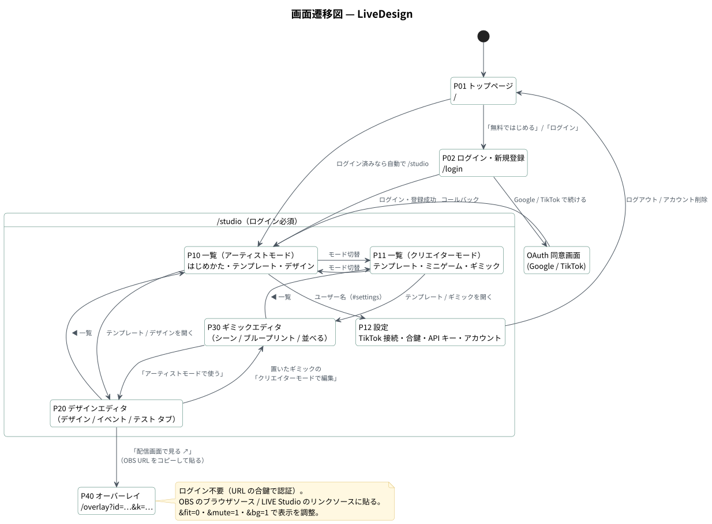
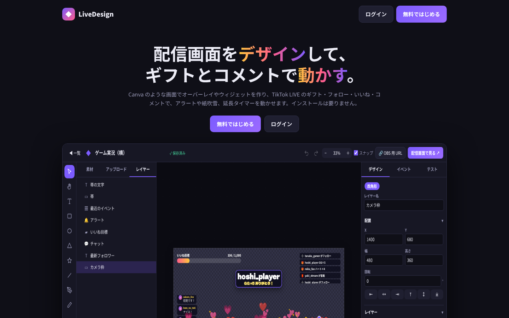
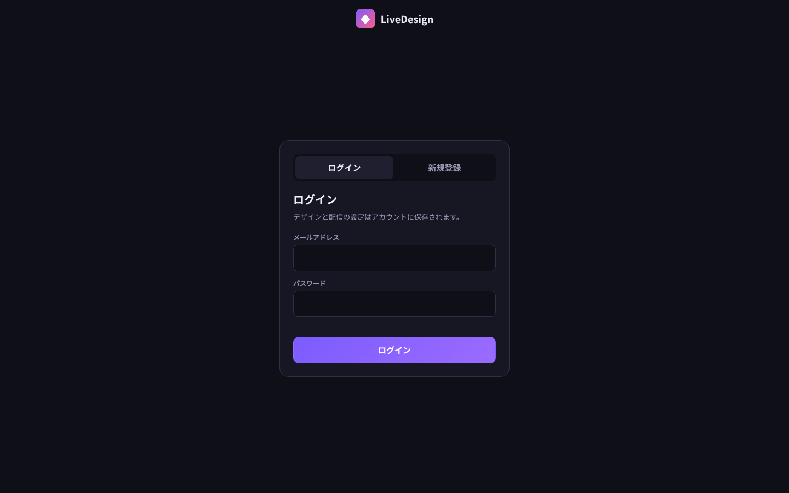
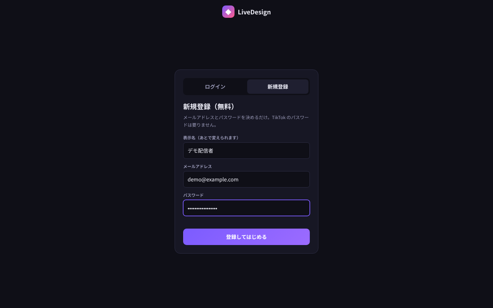
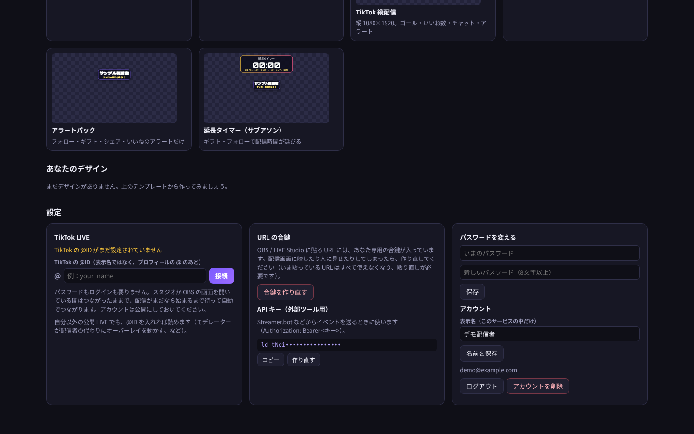

# 画面定義書 — LiveDesign

| 項目 | 内容 |
|---|---|
| 対象 | LiveDesign（Web サービス。PC ブラウザ＋OBS / TikTok LIVE Studio） |
| ページ | 4 ページ（`/`・`/login`・`/studio`・`/overlay`）。`/studio` はシングルページで 5 画面を切り替える |
| 画面遷移図 | [diagrams/svg/screen-transition.svg](diagrams/svg/screen-transition.svg) |
| 共通仕様 | ダークテーマ。すべてのページに CSP（スクリプトは自サイトのファイルだけ）。視聴者の名前とコメントは必ず文字として描画（HTML として解釈しない） |

---

## 1. 画面一覧

| ID | 画面名 | URL | 認証 | 実装 | 概要 |
|---|---|---|---|---|---|
| P01 | トップページ | `/` | — | `public/index.html` | サービス紹介と登録への導線（ログイン済みなら `/studio` へ） |
| P02 | ログイン・新規登録 | `/login` | — | `public/login.html`, `js/site/login.js` | メール／Google／TikTok |
| P10 | 一覧（アーティストモード） | `/studio` | Cookie | `js/studio/editor/home.js` | はじめかた・テンプレート・自分のデザイン |
| P11 | 一覧（クリエイターモード） | `/studio` | Cookie | `js/studio/creator/home.js` | テンプレート・ミニゲーム・自分のギミック |
| P12 | 設定 | `/studio#settings` | Cookie | `js/studio/editor/home.js` | TikTok 接続・合鍵・API キー・パスワード・アカウント |
| P20 | デザインエディタ | `/studio` | Cookie | `js/studio/editor/*` | キャンバス・レイヤー・プロパティ・イベント・テスト |
| P30 | ギミックエディタ | `/studio` | Cookie | `js/studio/creator/*` | ヒエラルキー・シーン・ブループリント・コンソール・インスペクター |
| P40 | オーバーレイ | `/overlay?id=…&k=…` | URL の合鍵 | `public/overlay.html`, `js/studio/overlay.js` | OBS・LIVE Studio に貼る配信画面 |

---

## 2. 画面詳細

### P01 トップページ

| No | 項目 | 種別 | 内容 |
|---|---|---|---|
| 1 | ロゴ | リンク | |
| 2 | ログイン ／ 無料ではじめる | ボタン | P02 へ（「無料ではじめる」は新規登録タブを開く） |
| 3 | キャッチコピー | テキスト | 「配信画面をデザインして、ギフトとコメントで動かす。」 |
| 4 | 製品画像 | 画像 | エディタ・オーバーレイ・ルール・縦配信の画面 |

---

### P02 ログイン・新規登録

 

| No | 項目 | 種別 | 必須 | 入力チェック・内容 |
|---|---|---|---|---|
| 1 | ログイン ／ 新規登録 | タブ | — | 新規登録を止めているときは登録タブの代わりに案内を表示 |
| 2 | 表示名 | テキスト（最大 60） | 任意 | 新規登録のみ。空ならメールの @ より前 |
| 3 | メールアドレス | メール | 必須 | 形式チェック・254 文字以内 |
| 4 | パスワード | パスワード | 必須 | 8〜200 文字 |
| 5 | ログイン ／ 登録してはじめる | ボタン | — | 成功で `next` パラメータの先（自サイト内だけ）または `/studio` |
| 6 | Google で続ける ／ TikTok で続ける | ボタン | — | OAuth の鍵が設定されているときだけ表示 |
| 7 | エラー表示 | テキスト | — | サーバーの日本語メッセージ（例「メールアドレスかパスワードが違います」） |

---

### P10 一覧（アーティストモード）／ P11 一覧（クリエイターモード）

 

| No | 項目 | 種別 | 内容 |
|---|---|---|---|
| 1 | ＋ 白紙から作る ／ キャンバスサイズ | ボタン・選択 | 横 1920×1080・縦 1080×1920 など |
| 2 | ユーザー名 | リンク | P12 設定へ |
| 3 | モード切替 | カード 2 枚 | アーティストモード ⇔ クリエイターモード |
| 4 | はじめかた（3 ステップ） | 案内 | ① TikTok の @ID を入れて「接続」② デザインを作る ③ OBS に URL を貼る。済んだステップにはチェック |
| 5 | テンプレートから作る | カード | アーティスト：白紙・ゲーム実況・TikTok 縦配信・配信開始前・アラートパック・延長タイマー。クリエイター：ブロック崩し・ギフトの雨・コメント綱引き・演出パック・いいねで大爆発・効果音パック・コメント投票 |
| 6 | ミニゲーム（P11） | カード | アクション・シューティング・運・レース・推理・RPG の 6 ジャンル |
| 7 | あなたのデザイン ／ ギミック | カード | 開く・複製・名前の変更・書き出し（JSON）・削除。JSON の読み込み |

---

### P12 設定

| No | グループ | 項目 | 種別 | 内容 |
|---|---|---|---|---|
| 1 | TikTok LIVE | 接続状態 | テキスト | 未設定／接続中／接続済み／配信開始待ち／エラー |
| 2 | TikTok LIVE | @ID ＋ 接続 | 入力＋ボタン | `https://www.tiktok.com/@name` を貼っても @ID に整える。英数字・ピリオド・アンダーバー |
| 3 | URL の合鍵 | 合鍵を作り直す | 危険操作 | 確認後、古い URL の OBS は即座に切断 |
| 4 | API キー | キー（伏せ字）・コピー・作り直す | 表示＋ボタン | Streamer.bot などからの連携用 |
| 5 | パスワードを変える | いまのパスワード・新しいパスワード（8 文字以上）・保存 | 入力 | 変更するとほかの端末のログインは切れる |
| 6 | アカウント | 表示名・名前を保存 | 入力 | |
| 7 | アカウント | ログアウト ／ アカウントを削除 | ボタン | 削除はパスワード確認のうえ、デザイン・ギミック・素材もすべて削除 |

---

### P20 デザインエディタ（アーティストモード）

| エリア | 項目 | 内容 |
|---|---|---|
| ヘッダー | ◀ 一覧・名前・保存状態・Undo/Redo・ズーム・スナップ・OBS 用 URL・配信画面で見る ↗ | 自動保存。「OBS 用 URL」はコピー |
| 左ツールバー | 選択（V）・手のひら（H）・テキスト（T）・四角形（R）・円（O）・三角形（Y）・星（S）・直線（L）・ペン（P）・鉛筆（B） | |
| 左パネル | 素材 ／ アップロード ／ レイヤー | 素材：ウィジェット・テキストのプリセット・ギミック。アップロード：画像・動画・音（ドラッグ＆ドロップ・貼り付け可）。レイヤー：並べ替え・グループ化・表示・ロック |
| 中央 | キャンバス | 変形（Shift・Alt）・スマートガイド・ペンでのベジェ編集・キャンバス上での文字編集 |
| 右パネル「デザイン」 | 配置・レイヤー（不透明度・描画モード 16 種）・塗り（単色／グラデーション）・線・文字・効果・アニメーション | 選択中の要素の種類に応じて変わる |
| 右パネル「イベント」 | ルール一覧と編集 | きっかけ（ギフト・コメント・いいね・フォロー…）・条件・クールダウン・アクション（上から順に実行） |
| 右パネル「テスト」 | コメント・ギフト・フォローなどを流す | 本番と同じ判定を通る |

| ルールの項目 | 入力 | 入力チェック・ルール |
|---|---|---|
| きっかけ | ギフト／コメント／いいね／フォロー／シェア／入室／宝箱／すべて | |
| ギフト名 | テキスト（カンマ区切りで複数） | 最大 80 文字 |
| 最低コイン・最高コイン | 数値 | 0〜10 億。連打は合計で判定 |
| コメントの一致 | どれでも／コマンド／含む／完全一致 | `!jump` は `!jumpman` に反応しない。全角・半角カナも同じに読む |
| いいね N 件ごと | 数値 | 塊で届いても跨いだ回数ぶん数える |
| この人だけ | テキスト | 名前・@ID をカンマ区切り |
| クールダウン ／ 1 人ごと | 秒 | 0〜86,400 |
| アクション | 最大 12 個 | アラート・音・要素を動かす・表示／非表示・パーティクル・読み上げ・文字の差し替え・カウンター・タイマー・ギミックに合図 |

---

### P30 ギミックエディタ（クリエイターモード）

 

| エリア | 内容 |
|---|---|
| 上 | 名前・種類・保存・Undo/Redo・▶ 再生 ⏸ 一時停止 ⏭ コマ送り ⏹ 停止・JSON 書き出し・アーティストモードで使う |
| 左「ヒエラルキー」 | ステージのオブジェクトとプレハブ。👁 で「最初は隠す」 |
| 左「アセット」 | サウンド・エフェクト・変数 |
| 中央「シーン」 | ステージ。停止中はドラッグで配置、再生中は本番と同じエンジンで動く |
| 中央「ブループリント」 | ノードの配置・ピンの接続・パレット・コメント・マイブループリント（関数・マクロ） |
| 中央「並べる」 | シーンとブループリントを横に並べ、動いたノードが光るのを見ながら確認 |
| 下「コンソール」 | Print の出力・式のまちがい・止めた理由。合図・ギフト・コメント・いいね…を流すボタン |
| 右「インスペクター」 | 選択中のオブジェクト・サウンド・エフェクト・変数・ノード・関数の設定 |

---

### P40 オーバーレイ

| 項目 | 内容 |
|---|---|
| 表示 | 指定したデザインを、届いたイベントに合わせて描画（チャット・弾幕・アラート・ゴール・ランキング・最近のイベント・タイマー・ギミック） |
| 更新 | デザインやギミックを保存するとその場で描き直す（OBS を触らずに見た目を直せる） |
| URL パラメータ | `&fit=0`（等倍で左上に置く）・`&mute=1`（音と読み上げを出さない）・`&bg=1`（確認用の市松模様） |
| 認証 | URL の合鍵。作り直すと古い URL は表示されなくなる |

 
