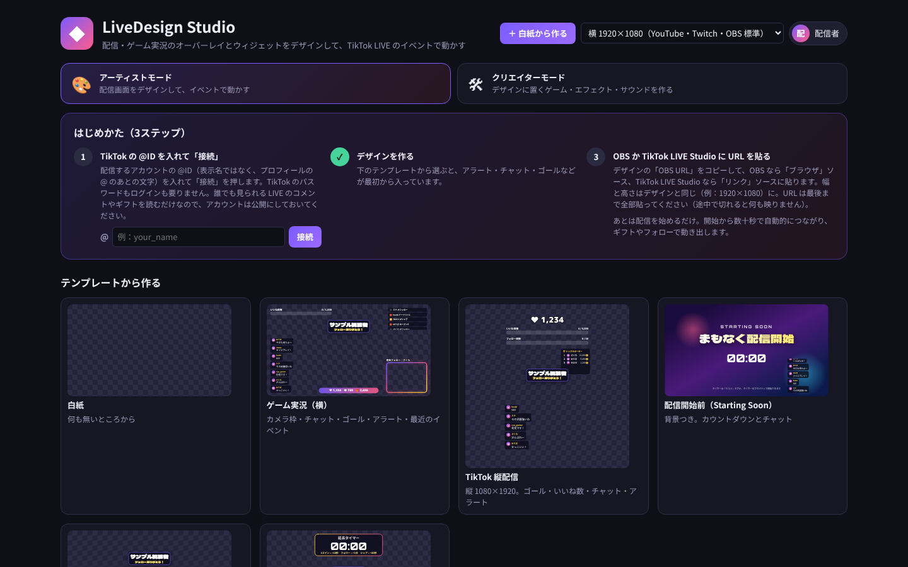
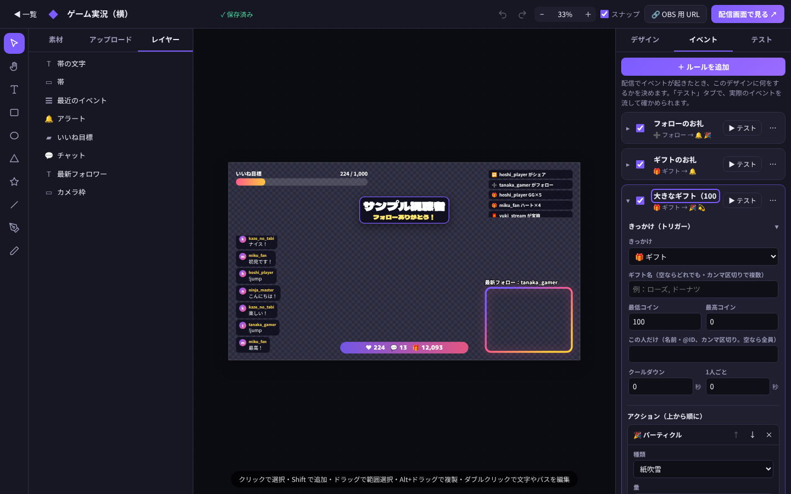
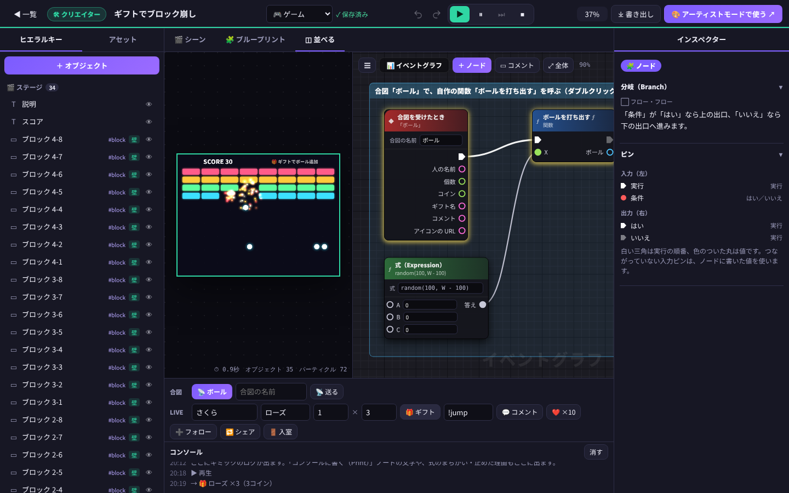
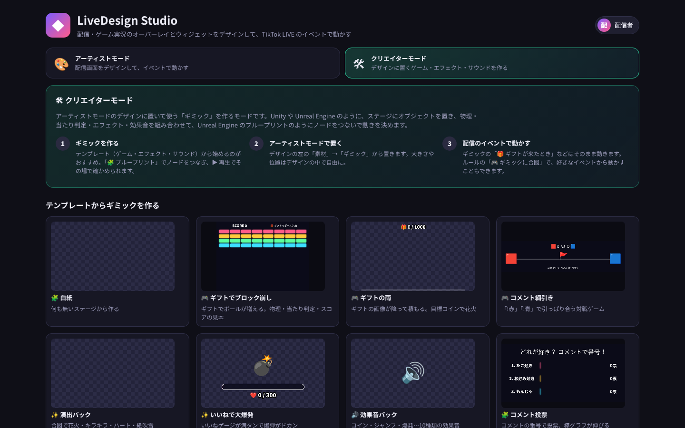
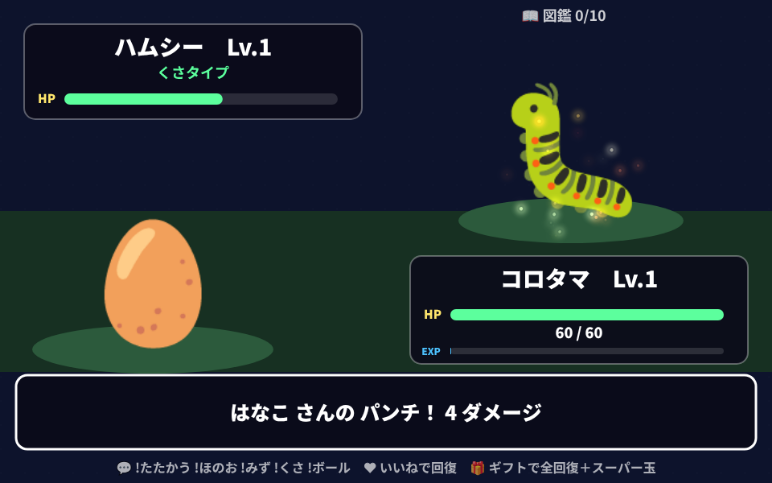
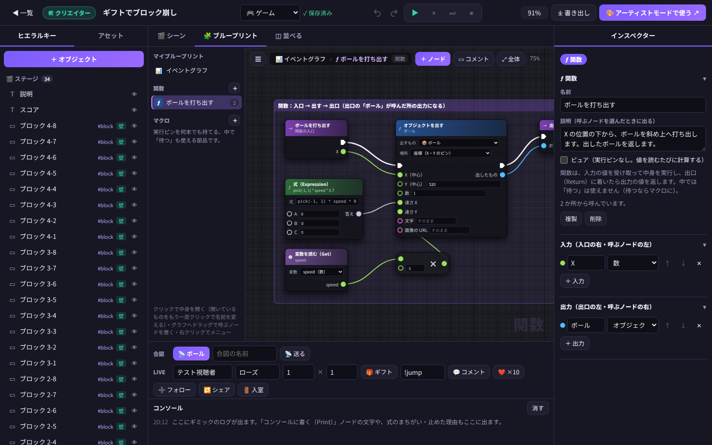
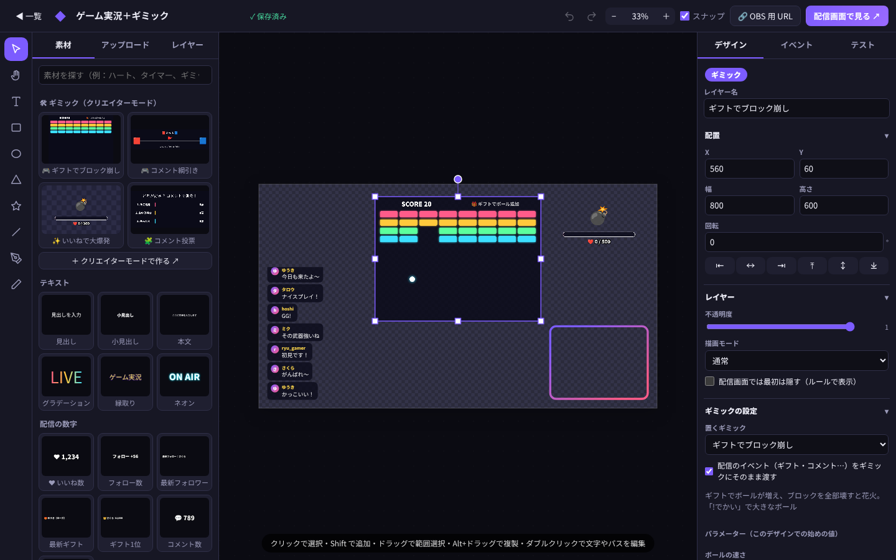

# LiveDesign

[](https://github.com/sawai-naoki-portfolio/LiveDesign/actions/workflows/test.yml)

> **ポートフォリオ作品**（[作品一覧へ](https://github.com/sawai-naoki-portfolio)）。設計資料（要件定義書・画面定義書・設計書・テスト結果・UML 図）は [`Doc/`](Doc/README.md) にあります。
>
> | 項目 | 内容 |
> |---|---|
> | 開発 | 個人開発。企画・仕様決め・設計の判断・レビュー・テストでの検証は自分で行い、実装とドキュメント作成には生成 AI（Claude Code）を活用 |
> | 開発時期 | 2026 年 8 月〜10 月（コミットの記録: 8/11〜10/18） |
> | 公開状況 | 未公開（手元や Docker で起動して試せる） |

配信・ゲーム実況用の**ウィジェットデザインツール**を、誰でも登録して使える Web サービスとして動かすためのものです。
モードは2つあります。

| モード | すること |
|---|---|
| 🎨 **アーティストモード** | 配信画面（オーバーレイ・ウィジェット）をデザインして、TikTok LIVE のイベントで動かす |
| 🛠 **クリエイターモード** | アーティストモードのデザインに置いて使う**ギミック**（ゲーム・エフェクト・サウンド…）を、Unity / Unreal Engine のような画面で作る（[下で詳しく](#クリエイターモードギミックを作る)） |

- 🎨 **デザイン** … Canva・Photoshop・Illustrator のような画面で、配信画面のオーバーレイやウィジェットを作る
  （図形・ペンツール・グラデーション・レイヤー・描画モード・アニメーション・テンプレート）
- ⚡ **イベント → アクション** … TikFinity のように「ギフト100コイン以上で紙吹雪と効果音」
  「`!jump` で読み上げ」「フォローで延長タイマー +1分」をノーコードで組み立てる
- 🛠 **ギミックを作る** … ステージにオブジェクトを置き、物理・当たり判定・パーティクル・効果音（シンセ）を組み合わせ、
  **Unreal Engine のブループリントのようにノードをつないで**「ギフトでボールが降る」「コメントで綱引き」「いいねで爆発」のようなゲームや演出を作る
- 📺 **OBS・TikTok LIVE Studio に URL を貼るだけ** … 保存すると配信画面にその場で反映される
- 👥 **会員登録して使う** … メールアドレスか Google / TikTok で登録。TikTok の @ID を入れれば、
  配信を始めたときに自動でつながる（TikTok のパスワードは預からない）


> **設計ドキュメント** — 要件定義書・画面定義書・設計書（構成図／クラス図／シーケンス図／画面遷移図／ER 図）・API 仕様書・テスト結果は
> [`Doc/`](Doc/README.md) にまとめています。

---

## 配信する人の使い方

1. トップページの「無料ではじめる」から登録する（メールアドレス、または Google / TikTok）
2. 「はじめかた」の欄に、配信するアカウントの **TikTok の @ID** を入れて「**接続**」を押す
   （表示名ではなくプロフィールの @ のあとの文字。`https://www.tiktok.com/@name` を貼ってもよい）。
   TikTok のパスワードもログインも要りません。アカウントは公開にしておいてください
3. テンプレート（ゲーム実況・TikTok 縦配信・配信開始前・アラートパック・延長タイマー・白紙）からデザインを作る
4. デザインの「OBS URL」をコピーして、OBS の **ブラウザ** ソース、または TikTok LIVE Studio の **リンク** ソースに貼る。
   幅と高さはデザインと同じにする（例：1920×1080）
5. 配信を始める。数十秒で自動的につながり、ギフトやフォローで動き出す



- エディタの右の「テスト」タブから、コメント・ギフト・フォローを流して動きを確かめられます
- OBS 用の URL には**その人専用の合鍵**が入っています。配信画面に映してしまったら、設定の「合鍵を作り直す」で作り直してください（前の URL は使えなくなります）
- TikTok に繋がるのは、スタジオか OBS の画面を開いている間だけです。配信がまだ始まっていなければ、始まるまで待って繋ぎ直します
- 読むのは誰でも見られる LIVE のコメントやギフトだけなので、**自分以外の公開 LIVE でも @ID を入れれば読めます**
  （モデレーターが配信者の代わりにオーバーレイを動かす、など）。@ID が本人のものかは確かめません（TikFinity と同じ）

### デザインの機能（アーティストモード）

| 機能 | 内容 |
|---|---|
| 道具 | 選択（V）・手のひら（H／スペース）・テキスト（T）・四角形（R）・円（O）・三角形（Y）・星（S）・直線（L）・**ペン**（P）・**鉛筆**（B） |
| ペン（Illustrator 風） | クリックで角の点、ドラッグでなめらかな点（ベジェ曲線）。始点をクリックで閉じる／Enter・ダブルクリックで終了／Backspace で1つ戻す |
| 点の編集 | パスをダブルクリック（または Enter）。点・ハンドルをドラッグ、Alt+クリックで角⇔なめらか、Delete で点を消す |
| 変形 | 移動・拡大縮小（Shift で縦横比固定・Alt で中心から）・回転（Shift で15°刻み）・矢印キーで1px（Shift で10px）・Alt+ドラッグで複製 |
| スマートガイド | キャンバスの端・中心、ほかの要素の端・中心にぴったり吸着（Ctrl を押している間は無効） |
| 塗りと線 | 単色・線形／円形グラデーション（色は最大6つ・不透明度つき・スポイト）、線の太さ・破線・点線・線端・角 |
| 文字 | 日本語を含む Google Fonts 30種、太さ・斜体・字間・行間・縁取り・グラデーション文字。キャンバス上で直接編集 |
| 効果 | ドロップシャドウ、ぼかし・明るさ・コントラスト・彩度・色相・モノクロ・反転、描画モード16種、不透明度 |
| アニメーション | 登場（フェード・スライド・ポップ・バウンド・フリップ…）とループ（鼓動・浮遊・回転・発光・虹色…） |
| レイヤー | 並べ替え（ドラッグ）・グループ化（Ctrl+G）・表示／ロック・名前の変更。グループはダブルクリックで中へ |
| 素材 | PNG/JPEG/GIF/WebP/AVIF の画像、**透過 WebM** などの動画、MP3/WAV/OGG の効果音をアップロード（ドラッグ＆ドロップ・貼り付けも可） |
| 元に戻す | Ctrl+Z / Ctrl+Shift+Z（Ctrl+Y）。コピー・貼り付けは別のデザインにも貼れる |
| 書き出し | デザインを JSON で書き出し・読み込み（バックアップ・共有用） |

### 配信ウィジェット

| ウィジェット | 内容 |
|---|---|
| 💬 チャット | コメントを吹き出しで並べる（アイコン・名前・色・角丸・消えるまでの秒数） |
| ≋ 弾幕 | コメントがニコ生風に右から左へ流れる（段が重ならない） |
| 🔔 アラート | ルールの「アラートを出す」で表示する枠。見出し・メッセージ・画像（その人のアイコン／ギフト画像／素材）・効果音。重なったら順番待ち |
| ▰ ゴール | いいね・フォロー・コイン・カウンターなどの目標ゲージ（バー／リング） |
| 🏆 ランキング | 今回の配信のギフト額上位 |
| ☰ 最近のイベント | 直近のフォロー・ギフト・シェア・宝箱 |
| ⏱ タイマー | カウントダウン（延長タイマー・配信開始までの時間）。ルールで時間を足せる |
| 🛠 ギミック | クリエイターモードで作ったゲーム・エフェクト・サウンド。素材パネルの「ギミック」から置く（[下で詳しく](#アーティストモードで使う)） |

### 文字に値を差し込む

テキストに `{likes}` のように書くと、配信の値に置き換わります（エディタの「{ }」ボタンから選べます）。
`{likes|k}` で `1.2K`、`{likes|raw}` で区切りなし。

| 値 | 内容 |
|---|---|
| `{likes}` `{followers}` `{shares}` `{coins}` `{gifts}` `{comments}` `{joins}` | 今回の配信の数（いいねは配信の累計） |
| `{lastFollower}` `{lastGifter}` `{lastGift}` `{lastCommenter}` `{lastComment}` `{lastSharer}` | 最新の人・ギフト・コメント |
| `{top1Name}` `{top1Coins}` `{top2Name}` `{top3Name}` | ギフト額のランキング |
| `{カウンター名}` / `{タイマー名}` | 自分で作ったカウンターの値・タイマーの残り（例：`デス数 {deaths}`） |
| `{user}` `{gift}` `{count}` `{giftCoins}` `{comment}` `{args}` `{likeCount}` | アラート・読み上げなど、**イベントのアクションの中だけ**で使える値（`{args}` はコマンドの後ろの文字） |

### イベントとアクション（ルール）



| きっかけ | 条件 |
|---|---|
| 🎁 ギフト | ギフト名（複数可）・最低／最高コイン（連打は合計で判定） |
| 💬 コメント | どれでも／コマンド（`!jump`。`!jumpman` には反応しない）／含む／完全一致。全角（`！ｊｕｍｐ`・`１`）や半角カナも同じに読む |
| ❤️ いいね | N 件ごと（塊で届いても跨いだ回数ぶん数える） |
| ➕ フォロー・🔁 シェア・🚪 入室・🧧 宝箱・✳️ すべて | — |

どのきっかけにも「この人だけ」の絞り込みと、**クールダウン**（全体・1人ごと）を付けられます。

| アクション | 内容 |
|---|---|
| 🔔 アラートを出す | アラート枠に見出し・メッセージ・画像・効果音を出す |
| 🔊 音を鳴らす | アップロードした効果音 |
| 💫 要素を動かす | 揺らす・ドクン・跳ねる・回転・フラッシュ・ゼリー・ジャーン・ハートビート |
| 👁 表示／非表示 | 要素を出す・隠す・切り替える（秒数で元に戻す）。「最初は隠す」と組み合わせて隠し演出に |
| 🎉 パーティクル | 紙吹雪・ハート・スター・雪・絵文字の雨・**ギフト画像の雨**・花火 |
| 🗣 読み上げ | 文を読み上げる（言語・速さ・高さ） |
| ✏️ 文字を差し替え | テキストを一定時間だけ別の文字に |
| 🔢 カウンター | 足す・引く・値にする・0に。量は固定／× コイン／× 個数／× いいね |
| ⏱ タイマー | 時間を足す（延長）・引く・開始・停止。「1コインにつき10秒」もできる |
| 🎮 ギミックに合図 | 置いたギミックに合図（例：`drop`）を送る。イベントの人・ギフト・個数・コメントも一緒に渡る |

### OBS・TikTok LIVE Studio に貼るときの注意


- 手元の PC で動かしているときの URL は `http://127.0.0.1:3000/overlay?…` になります。
  TikTok LIVE Studio は `localhost` の URL を表示できないことがあるので、`localhost` に書き換えずにそのまま貼ってください
- OBS の「表示されていないときにソースをシャットダウンする」はオフに（オンだとチャットや弾幕が止まります）
- 効果音は OBS の「OBS で音声を制御する」をオンにするとミキサーに出ます
- 読み上げはブラウザの音声合成を使うため、OBS の中では環境によって声が出ないことがあります。
  そのときは同じ URL を普通のブラウザでも開き、OBS 側は URL の後ろに `&mute=1` を付けます

| URL の後ろ | 内容 |
|---|---|
| `&fit=0` | 画面に合わせて縮めない（等倍で左上に置く） |
| `&mute=1` | 音と読み上げを出さない |
| `&bg=1` | 確認用の暗い市松模様を敷く（白い文字が見やすくなる。配信に貼る URL には付けない） |

### 外部ツールから使う（API キー）

設定の「API キー」を使うと、Streamer.bot などからイベントを送れます。本番と同じ判定（ルール・ウィジェット）を通ります。

```bash
curl -X POST https://livedesign.example.com/api/studio/event \
  -H "Authorization: Bearer ld_xxxxxxxx" -H "Content-Type: application/json" \
  -d '{"type":"gift","user":{"name":"さくら"},"gift":{"name":"ローズ","coin":1,"count":5}}'
```

`type` は `chat`（`text`）・`gift`（`gift`）・`follow`・`share`・`like`（`likes`）・`join`・`envelope`（`coins`）。
カウンター・タイマーは `POST /api/studio/vars`（`{"kind":"counter","name":"deaths","op":"add","value":1}`）、今の値は `GET /api/studio/vars`。

API キーで使えるのはこの3つだけです。デザインの読み書きやアカウントの設定（パスワード・合鍵・削除）には使えないので、
キーが漏れてもアカウントは乗っ取られません（漏れたら設定の「作り直す」で取り替えてください）。

---

## クリエイターモード（ギミックを作る）

アーティストモードのデザインに置いて使う「**ギミック**」を作るモードです。一覧の上の「🛠 クリエイターモード」に切り替えます。
ギミックは Unity のプレハブのように何度でも置けて、クリエイターモードで直すと、置いてある全部のデザイン（OBS の画面も）がその場で変わります。



1. 一覧で「🛠 クリエイターモード」を選び、テンプレートから作る（白紙からでもよい）
2. ステージにオブジェクトを置き、「🧩 ブループリント」でノードをつないで「いつ・何をするか」を組み立てる
3. ▶ 再生して、下のコンソールから合図・ギフト・コメント・いいねを流して確かめる（配信中なら本物のイベントも届く）
4. アーティストモードのデザインで、素材パネルの「🛠 ギミック」から置く



| テンプレート | 種類 | 中身 |
|---|---|---|
| ギフトでブロック崩し | 🎮 ゲーム | ギフトでボールが増え、ブロックを壊すとスコア。全部壊すと花火で最初から（物理・当たり判定の見本） |
| ギフトの雨 | 🎮 ゲーム | ギフトの画像が降って床に積もる。合計コインが目標に届くと花火 |
| コメント綱引き | 🎮 ゲーム | 「!赤」「!青」のコメントで旗を引っぱり合う。端まで引いたチームの勝ち |
| 演出パック | ✨ エフェクト | 合図「花火」「キラキラ」「ハート」「紙吹雪」で画面いっぱいの演出。大きなギフトで自動で花火 |
| いいねで大爆発 | ✨ エフェクト | いいねでゲージが溜まり、満タンで爆弾がドカン（画面が揺れて光る） |
| 効果音パック | 🔊 サウンド | 合図の名前で 10 種類の効果音（コイン・ジャンプ・爆発・レーザー…） |
| コメント投票 | 🧩 その他 | コメント「1」「2」「3」で投票、棒グラフが伸びる。お題と選択肢はパラメーター |

#### ミニゲーム（6ジャンル）

一覧の「🕹 ミニゲーム」から作れます。どれも視聴者がコメント・いいね・ギフトで遊べて、勝負がつくと少し待って自動でもう一度始まります。
速さ・ライフ・そろいやすさなどはパラメーター（アーティストモードで置いたあとに変えられる）。中身は自作の関数・マクロの見本にもなっています。




| ジャンル | ミニゲーム | 遊び方 | 関数・マクロの見本 |
|---|---|---|---|
| 🏃 アクション | 障害物ジャンプ | コメント「ジャンプ」かいいね5件で、みんなで跳んで障害物をよける。走った距離がスコア（ベストは残る）。🎁 ギフトで3秒むてき | 関数「ジャンプ」（跳べたかを返す）・関数「やり直す」 |
| 🚀 シューティング | コメント迎撃 | コメントするたびに、左右に動くロケットが1発。落ちてくる敵を撃ち落とすと「+10 名前」。下まで来られるとライフ -1。🎁 ギフトで5方向に連射 | 関数「弾を撃つ」（横の速さを受け取り、弾を返す）・関数「やり直す」 |
| 🎰 運・ガチャ | ギフトスロット | 🎁 ギフトでスロットが回り、左から1つずつ止まる。3つそろえば JACKPOT。大きいギフトほどそろいやすく、個数ぶん・回っている間のギフトは順番待ち。💬「!スロット」でも1回 | マクロ「3つ止める」（中でマクロ「リールを止める」を呼ぶ）・マクロ「当たりを発表」・ピュア関数「役」・関数「リールを回す」 |
| 🏇 レース | コメント競馬 | コメント「1」〜「4」で応援した子が前へ。いちばん先にゴールした子と、とどめを応援した人を発表。🎁 ギフトでいちばん後ろの子がターボ | 関数「進める」（今の位置を受け取り、新しい位置を返す）・関数「次のレース」 |
| 🧠 推理 | 数当てゲーム | 1〜100 のどれかをコメントで当てる。外れると「もっと大きい／小さい」で範囲の棒が縮む。🎁 ギフトでヒント（範囲が半分に） | マクロ「正解を発表」・関数「新しい問題」・関数「範囲を表示」 |
| 🐉 RPG | ミニモンスター | とびだしてくる野生のモンスターと視聴者みんなでバトル。💬 !たたかう・!ほのお・!みず・!くさ（ほのお→くさ→みず→ほのお で2倍）でこうげき、弱らせて !ボール でつかまえ図鑑（10匹・レアあり）をうめる。あいても一定時間ごとに反撃。経験値でレベルアップし、相棒はレベル5・10で しんか。❤ いいねで回復、🎁 ギフトで全回復＋スーパーつかまえ玉 | ピュア関数「モンスターの情報」（番号から choose() で表を引く）・ピュア関数「相性」・関数「こうげき」「次のモンスター」「経験値」「図鑑に登録」「HPを表示」・マクロ「つかまえ玉を投げる」（出口が2つ：つかまえた／にげられた。中でマクロ「ゆれる」）・マクロ「ゲットした」「しんか」 |

コメントの数字やコマンドは、全角（「１２」「！スロット」）や半角カナ（「ｼﾞｬﾝﾌﾟ」）でも同じに読みます。

### 画面（Unity / Unreal Engine と同じ並び）

| 場所 | 中身 |
|---|---|
| 上 | 名前・種類・保存・元に戻す／やり直し・**▶ 再生 ⏸ 一時停止 ⏭ コマ送り ⏹ 停止**（停止すると始めの状態に戻る）・JSON で書き出し |
| 左「ヒエラルキー」 | ステージのオブジェクトと 📦 プレハブ（イベントで何個も出すもの）。👁 で「最初は隠す」 |
| 左「アセット」 | 🔊 サウンド・✨ エフェクト・🔢 変数 |
| 真ん中「🎬 シーン」 | ステージ。止めているときはドラッグで移動、四隅で大きさ（Shift で縦横比）、Alt+ドラッグで複製。再生中は本番と同じエンジンで動き、クリックで「👆 クリックしたとき」が動く |
| 真ん中「🧩 ブループリント」 | ノードをつないでプログラミングする画面（[下で詳しく](#ブループリントノードでプログラミング)）。左の「マイブループリント」でイベントグラフと自作の関数・マクロを切り替える（[関数とマクロ](#関数とマクロを自作する)） |
| 真ん中「◫ 並べる」 | シーンとブループリントを横に並べる。再生中は、動いたノードが光るのを見ながら確かめられる |
| 下「コンソール」 | 「コンソールに書く（Print）」の出力・式のまちがい・止めた理由。合図・ギフト・コメント・いいね・フォロー…を流すボタン |
| 右「インスペクター」 | 選んでいるもの（オブジェクト・サウンド・エフェクト・変数・ノード・関数・マクロ）の設定。ノードなら説明とピンの一覧、関数・マクロなら名前・説明・入力と出力。何も選んでいなければステージの大きさ・背景・重力 |

キーボード：Ctrl+Enter 再生／停止・Esc 停止・Ctrl+Z / Ctrl+Shift+Z・Ctrl+S 保存・Ctrl+D 複製・Delete 削除・矢印で 1px（Shift で 10px）

### オブジェクト

| 項目 | 内容 |
|---|---|
| 形 | 四角形・円・三角形・星・文字・絵文字・画像。塗り・線・角の丸み・光（グロー） |
| 文字 | `{score}` や `{user} さん +{count * 10}点` のように、`{式}` を差し込める |
| タグ | `ball` `block` のような名前。ノードで「ball と block がぶつかったら」のように、まとめて扱う |
| 📦 プレハブ | 最初は出さず、「オブジェクトを出す」ノードで複製するもの（ギフトで降らせるボールなど） |
| 物理 | 動かない／物理で動く（重力・跳ね返り・床のすべりにくさ・空気の抵抗）／壁・床。速さ・回転の速さ |
| 画面の端 | 跳ね返る・止まる・反対側から出る・出たら消える・そのまま |
| 動きと寿命 | ふわふわ・ドクドク・ゆらゆら・点滅・ぶるぶる。何秒で消えるか。尾を引くエフェクト |

### ブループリント（ノードでプログラミング）

Unreal Engine の Blueprint と同じように、**ノード（箱）を置いて線でつなぐ**とプログラムになります。文字でコードを書く必要はありません。


| 色 | ノードの仲間 | 役目 |
|---|---|---|
| 🟥 赤 | イベント | きっかけ。ここから処理が始まる（ゲーム開始・合図・ぶつかった・ギフト…） |
| 🟦 青 | アクション | 白い**実行ピン**（三角）でつないだ順に実行する（出す・動かす・音・エフェクト…） |
| ⬜ 灰 | フロー | 実行の流れを変える（分岐・順番に・待つ・くり返す…） |
| 🟩 緑 | 計算（ピュア） | 実行ピンが無い。値を計算するだけ（足し算・比べる・ランダム・オブジェクトの情報…） |
| 🟪 紫 | 変数 | 変数を読む（変数に入れる・足すは青のアクション） |

**ピン**（つなぎ口）は左が入力・右が出力。白い三角が実行の順番、色の丸が値です（緑＝数・桃＝文字・赤＝はい／いいえ・青＝オブジェクト・灰＝なんでも）。
数・文字・はい／いいえは自動で変換してつながります。つながっていない入力ピンにはノードに直接値を書けて、
オブジェクトのピンが空なら「このイベントのオブジェクト」（ぶつかった自分・クリックした物など）になります。

| 操作 | 内容 |
|---|---|
| 右クリック・ダブルクリック・「＋ ノード」 | ノードを探して置く（「分岐」「ギフト」「足し算」のほか「Branch」など UE の名前でも探せる。変数・プレハブ・サウンドごとの近道もある） |
| ピンをドラッグ | ほかのピンへつなぐ。**何も無い所で離すと、つなげるノードだけのパレット**が出て、選ぶとつないだまま置かれる |
| Alt+クリック（ピン・線） | 線を外す。線をクリックして Delete でも外せる |
| ドラッグ | ノードを動かす（16px のマス目に吸着）。Alt+ドラッグで複製。何も無い所をドラッグで範囲選択 |
| 右ドラッグ・中ドラッグ・スペース＋ドラッグ / ホイール | 画面を動かす / 拡大縮小。F（⤢ 全体）で全部が見える大きさに |
| Ctrl+C / Ctrl+V / Ctrl+D / Delete | コピー・貼り付け（別のギミックにも貼れる）・複製・削除。Ctrl+Z で元に戻す |
| ▭ コメント | 選んだノードを囲むメモ。見出しをドラッグすると中のノードごと動く・ダブルクリックで名前・右クリックで色 |
| 右クリック（イベントノード）→「▶ 今すぐ動かす」 | 再生中に、きっかけを待たずにそのイベントを動かす |
| 右クリック（ノード）→「関数にまとめる」「マクロにまとめる」 | 選んだノードを新しい関数・マクロにする（下の[関数とマクロ](#関数とマクロを自作する)） |

再生中は、**動いたノードが光ります**（UE のデバッグ表示と同じ）。「◫ 並べる」にすると、ゲームとノードを同時に見られます。

| 仲間 | ノード |
|---|---|
| イベント | ゲームが始まったとき・毎フレーム（Tick）・一定時間ごと・合図を受けたとき・条件が成り立ったとき・ぶつかったとき・画面の端に着いたとき・クリックしたとき・オブジェクトが出てきたとき |
| TikTok LIVE | ギフトが来たとき（ギフト名・最低コイン）・コメントが来たとき（コマンド・含む・同じ）・いいねされたとき（N 件ごと）・フォロー・シェア・入室。人の名前・アイコン・ギフトの画像・個数・コインが出力ピンに出る。**ルールを作らなくても、置いたギミックにそのまま届く** |
| フロー | 分岐（Branch）・順番に（Sequence）・待つ（Delay）・くり返す（For Loop）・タグの全部に（For Each）・一度だけ（Do Once）・交互に（Flip Flop）・確率で分岐・クールダウン |
| オブジェクト | オブジェクトを出す（Spawn。出したものが出力ピンに）・消す・タグのものを全部消す・位置を決める・なめらかに移動・速さを決める（はじく）・相手に向かって進む |
| 見た目 | 文字・色・絵文字・画像・表示／隠す・大きさの倍率・回転・不透明度・幅と高さ・タグを変える |
| 演出 | 音を鳴らす・エフェクトを出す・オブジェクトの所にエフェクト・画面を揺らす・画面を光らせる |
| ゲーム | 合図を出す（Custom Event を呼ぶ）・最初からやり直す・コンソールに書く（Print） |
| 変数 | 変数を読む（Get）・変数に入れる（Set）・変数に足す |
| 計算・比べる・文字・情報 | ＋ − × ÷ ％・小さい方・大きい方・範囲に収める・整数にする・ランダムな数・**式**・＝ ≠ ＜ ≦ ＞ ≧・AND・OR・NOT・文字を作る（Format）・含む？・文字数・オブジェクトの情報（位置・速さ・まだあるか…）・タグで探す（数も）・置いたオブジェクト・ステージ |

例：「ギフトが来たら、個数ぶんボールを出して、コインの数だけスコアを足す」

```
[ギフトが来たとき] ─▶ [オブジェクトを出す: ボール] ─▶ [変数に足す: score]
       個数 ●──────────▶ 数                               足す数
       コイン ●────────────────────────────────────────▶ ●
```

#### 関数とマクロを自作する

よく使う処理は、**自分だけのノード**にまとめられます（UE の Function と Macro と同じ）。
ブループリントの左の「**マイブループリント**」で「関数 ＋」「マクロ ＋」を押すと作れて、クリックで中身のグラフが開きます
（上のパンくず「📊 イベントグラフ › ƒ 名前」で戻る）。



| | 関数 ƒ | マクロ ⇉ |
|---|---|---|
| 中身 | 紫の**入口**から始まり、**出口（Return）**に着いたら終わり。出口は分岐ごとに何個置いてもよい | 紫の**入口**から**出口**へ。実行ピンを何本でも持てる（「大きい」「小さい」のように出口を分けられる） |
| 入力と出力 | 数・文字・はい／いいえ・オブジェクト・なんでも | 関数と同じ ＋ **実行**（入口・出口の白い三角） |
| 「待つ」 | 使えない（すぐに答えを返すため。使うとコンソールに理由が出る） | 使える（待ったあと、呼んだ所の続きを動かす） |
| 覚えておく値 | 「一度だけ」「交互に」などは呼んだ場所ごとに別々 | 同じ（呼んだ場所ごとに別々） |
| ピュア | 「ピュア」にすると実行ピンが無くなり、計算ノード（緑）のように**読まれるたびに計算**する | 実行ピンを1つも持たないマクロは、計算ノードとして使える |

1. 「関数 ＋」で作ると、入口と出口がつながった中身が開く
2. 右のインスペクターで名前・説明を書き、「＋ 入力」「＋ 出力」でピンを足す（種類・順番・削除もここ。種類を変えると合わなくなった線は外れる）
3. 入口の右のピン（入力の値）から、出口の左のピン（出力の値）までノードをつなぐ
4. イベントグラフに戻り、マイブループリントの関数を**グラフへドラッグ**するか、パレットの「関数」「マクロ」から置く。呼ぶノードを**ダブルクリック**すると中身が開く

| 操作 | 内容 |
|---|---|
| マイブループリントの関数・マクロをクリック | 中身を開く（開いているものをもう一度クリックで名前を変える） |
| マイブループリントの関数・マクロを右クリック | 開く・呼ぶノードを置く・名前を変える・複製・削除（呼んでいるノードも一緒に消える。Ctrl+Z で戻せる） |
| ノードを選んで右クリック →「関数にまとめる」 | 外から入ってくる線が入力に、外へ出ていく線が出力になり、元の場所には呼ぶノードが1つ残る。計算ノードだけならピュア関数になる。「待つ」を含むときや、実行の出入りが2か所以上のときは「マクロにまとめる」 |

関数・マクロの中で、ほかの関数・マクロも呼べます（自分自身を呼ぶ関数は 16 段で止まります）。イベントのノードはイベントグラフにだけ置けます。

テンプレートの見本：ブロック崩し（関数「ボールを打ち出す」…X を受け取り、出したボールを返す。合図と「!でかい」の2か所から呼ぶ）・
演出パック（マクロ「花火を1発」…中で「待つ」を使い、3回つないで連発）・コメント投票（ピュア関数「棒の幅」）。

#### 式ノードと文字の差し込み

計算が長くなるときは「式」ノードが使えます（例：`random(100, W - 100)`、`a * 2 + score`）。
オブジェクトの文字やノードの文字の中では `{score}` や `{user} さん +{count * 10}点` のように `{式}` を差し込めます。

数・文字（`"…"` か `「…」`）・`+ - * / %`・比較（`== != < <= > >=`。`=` 1つでも比較）・`&& || !`（`and or not`）・`条件 ? A : B` が書けます。

| 名前 | 内容 |
|---|---|
| `a` `b` `c` | 式ノードの入力ピン A・B・C |
| 変数の名前（`score` など） | アセットの「🔢 変数」。日本語の名前も可 |
| `user` `count` `coins` `gift` `comment` `args` | イベントの人・ギフトの個数（いいねの数）・コイン・ギフト名・コメント・コマンドの後ろの文字 |
| `W` `H` `time` | ステージの幅・高さ・始まってからの秒数 |
| `self.x` `self.y` `self.vx` `other.x` … | このイベントのオブジェクト・相手の値（`cx` `cy` `w` `h` `vy` `rotation` `age` `user` も） |
| 関数 | `random(a, b)` `randint(a, b)` `chance(%)` `pick(…)` `min` `max` `clamp` `abs` `floor` `ceil` `round` `sqrt` `pow` `sin` `cos` `atan2` `dist` `lerp` `len` `has(文字, 部分)` `isnum(値)`（数として読めるか。コメントで数字を答えるゲームに） `choose(n, A, B, …)`（n 番目を選ぶ。番号から名前を引く表に） `count("タグ")` |

ノードも式も、ブラウザの中の決まった手順（`shared/gimmick/nodes.js`・`expr.js`）だけが読み、JavaScript としては実行しません。
人にもらったギミックの JSON を読み込んでも、ブラウザの中（ログイン・ほかのデザイン）には触れません。
実行の線がぐるぐる回る・合図が合図を呼び続ける・計算ノードが輪になる、といった作りでも、上限で止めてコンソールに理由を出します（配信は止まりません）。
「待つ」をはさんだ合図の連鎖（合図 → 待つ → 合図 → 待つ…）は、時間をかけた繰り返しなので止めません。

### サウンドとエフェクト

| アセット | 内容 |
|---|---|
| 🔊 サウンド | 音のファイル無しで、その場で作る効果音（波形・始めと終わりの高さ・長さ・メロディ `C5 E5 G5`・ビブラート・こもらせる）。プリセット 12 種と「🎲 ゆらす」。アップロードした MP3 / WAV / OGG も使える |
| ✨ エフェクト | パーティクル（まる・しかく・星・光の筋・輪っか・絵文字・画像）。数・出し続ける秒数・向きと広がり・速さ・重力・寿命・大きさの変化・回転・光・加算。プリセット 10 種（爆発・キラキラ・花火・紙吹雪・ハート・けむり・ほのお・衝撃波・雪・コインの噴水） |

### アーティストモードで使う



- デザインの左の「素材」→「🛠 ギミック」からクリック（またはドラッグ）で置く。大きさ・位置・回転・不透明度はほかの要素と同じ
- プロパティの「ギミックの設定」で、置くギミック・**パラメーター**（クリエイターモードで「アーティストモードで変えられるようにする」にした変数。例：目標のコイン）・合図を送って試す・「🛠 クリエイターモードで編集」
- ギミックの中の「🎁 ギフトが来たとき」などは、そのまま配信のイベントで動く（プロパティの「配信のイベントをそのまま渡す」でオフにできる）
- ルールのアクション「🎮 ギミックに合図」で、好きなきっかけ（大きなギフトだけ・特定のコマンドだけ…）からギミックを動かせる
- 一覧の「書き出し」で JSON にして、人に渡したりバックアップしたりできる（「JSON を読み込む」で取り込む）

---

## 運営する人向け

### 必要なもの

| もの | 用途 |
|---|---|
| Node.js **22.13 以上**（Docker なら不要） | データベースに Node 標準の SQLite を使う |
| サーバー（VPS・クラウドのコンテナなど） | 常時動かす。メモリ 1GB から始められる |
| ドメインと HTTPS | ログインの Cookie を守るため必須。Caddy なら証明書を自動で取る |
| [Euler Stream](https://www.eulerstream.com/) の API キー | TikTok LIVE のイベントを受けるための署名。**サービス全体で1つ**。同時に繋ぐ @ID の数に合ったプランを選ぶ（同じ @ID を何人が入れても接続は1本） |
| （任意）Google / TikTok の OAuth の鍵 | 「Google で続ける」「TikTok で続ける」を出すとき |

### 手元で試す

```bash
npm install
DEMO_MODE=true npm start     # TikTok に繋がず、ダミーのイベントを流す
```

http://localhost:3000/ を開いて登録します。Windows は `start.bat` でも起動できます。
本物の TikTok LIVE で試すときは `.env` に `EULER_API_KEY` を入れて `npm start` で起動し、
スタジオで自分の @ID を入れます。

### サーバーに置く（Docker）

```bash
cp .env.example .env    # PUBLIC_URL・EULER_API_KEY などを入れる
docker build -t livedesign .
docker run -d --name livedesign --restart unless-stopped \
  --env-file .env -p 127.0.0.1:3000:3000 -v livedesign-data:/app/data livedesign
```

前に HTTPS のリバースプロキシを置きます。Caddy なら次の2行で、証明書の取得と更新までやってくれます
（`/etc/caddy/Caddyfile`）。WebSocket もそのまま通ります。

```
livedesign.example.com {
  reverse_proxy 127.0.0.1:3000
}
```

`.env` は `PUBLIC_URL=https://livedesign.example.com`・`TRUST_PROXY=true` にします。
設定の一覧と説明は [`.env.example`](.env.example) にあります。

### 運用

| やること | 方法 |
|---|---|
| パスワードを忘れた人 | `npm run admin -- reset-password <メール> <新しいパスワード>`（Docker なら `docker exec livedesign npm run admin -- …`） |
| 利用者の一覧・プラン | `npm run admin -- users` / `npm run admin -- set-plan <メール> pro` |
| バックアップ | `data/`（Docker ならボリューム `livedesign-data`）を丸ごと。中身はデータベース `livedesign.db`（デザイン・ギミック）と素材 `assets/` |
| 新規登録を止める | `REGISTRATION=closed` で再起動（ログインはできる） |
| 生きているかの確認 | `GET /healthz`（データベースまで読めれば `{"ok":true}`、読めなければ 503） |
| 止める・入れ替える | `docker stop`（SIGTERM）か Ctrl+C。受付をやめ、開いている画面に「止めます」と伝え、カウンターを書き出してデータベースを閉じてから終わる（5秒で打ち切り）。画面は再起動のあと自動で繋ぎ直す |
| 設定の見落とし | 起動したときに `⚠` で出す（`EULER_API_KEY` が空・外から繋がるのに https でない、など） |
| 利用者ごとの上限 | `MAX_SCENES_PER_USER`（デザインの数）・`MAX_GIMMICKS_PER_USER`（ギミックの数）・`STORAGE_QUOTA_MB`（素材の容量）・`MAX_LIVE_CONNECTIONS`（同時に繋ぐ TikTok の @ID の数） |
| 1人用だった頃のデータ | `data/studio/` があれば、**最初に登録した人**がデザイン・素材・カウンターを引き継ぐ（終わると `studio.migrated` に名前が変わる） |

### 公開する前に決めること（まだ作っていないもの）

- **利用規約とプライバシーポリシー**のページ（TikTok の Login Kit の審査でも求められます）
- **パスワードを忘れたとき**に本人が再設定する仕組み（メールの送信サービスが要ります。今は Google / TikTok でのログインか、運営が `npm run admin -- reset-password` で対応）
- **有料プラン**（今は全員が同じ上限。Stripe などで課金を足すときは `users.plan` を使う）
- TikTok との接続に使っている [tiktok-live-connector](https://github.com/zerodytrash/TikTok-Live-Connector) は
  **TikTok 非公式**のライブラリです。TikTok 側の変更で突然動かなくなることや、利用規約との関係を理解したうえで公開してください

---

## 仕組み

```
                      ┌──────────── server/live.js ────────────┐
TikTok LIVE ──(tiktok-live-connector + 運営の Euler API キー)──→ @ID ごとに1本の接続
                      │  @ID を入れた人の画面が開いている間だけ繋ぎ、│
                      │  届いたイベントをその @ID を読む全員に配る   │
                      └──────────────────┬─────────────────────┘
                                         │ studioIngest(userId, …)    ← デモモード（server/demo.js）
                                         ▼
                 server/studio.js + workspace.js：その人のルールの判定・カウンター・タイマー
                                         │ WebSocket（その人の画面にだけ配る）
                     ┌───────────────────┴───────────────────┐
                     ▼                                       ▼
        /studio（エディタ。ログインの Cookie）     /overlay?id=…&k=…（OBS。URL の合鍵）
```

### フォルダ

```
index.js        起動と配線だけ（/healthz と、止めるときの片付けも）
server/         サーバーの処理（依存は config → net → db → auth → workspace / assets → studio → live / demo → index の一方向）
lib/            サーバーにもブラウザにも依存しない計算（テスト対象）
public/         ブラウザに配るもの ←★ここが公開範囲そのもの
data/           実行時に読み書きするもの（Git 管理外。データベースと素材）
test/           自己テスト（npm test）
```

| ファイル | 役割 |
|---|---|
| `server/config.js` | 設定（`.env` から。定数のみ。環境変数を読むのはここだけ） |
| `server/net.js` | HTTP と WebSocket の口。接続ごとに持ち主を覚え、その人の画面にだけ配る。よそのページからの書き込みを断る・CSP などの守り・失敗を JSON で返す・応答の無い接続を切る |
| `server/db.js` | データベース（Node 標準の SQLite）。表の追加は `MIGRATIONS` の末尾に足す |
| `server/auth.js` | 利用者・ログイン（メール・Google・TikTok）・セッション・合鍵・API キー・アカウント設定・ページの出し分け |
| `server/workspace.js` | 利用者ごとの作業場（デザイン・カウンター・ルールの判定・今回の数字）。使っている人の分だけメモリに持つ |
| `server/studio.js` | デザイン・ギミックの REST（本人のものだけ。どちらも `documentRoutes` の同じ形）、オーバーレイ向けの読み出し（合鍵。置いたギミックの中身を添える）、イベント → アクション |
| `server/assets.js` | 素材（画像・音・動画）の REST と `/studio-assets/` での配布・容量・アカウントを消したときの片付け |
| `server/live.js` | TikTok LIVE の接続（@ID ごとに1本を、読んでいる人みんなで共有）。配信が始まるまで間隔を広げながら待つ・切れたら繋ぎ直す |
| `server/demo.js` | デモモード（画面を開いている人にダミーのイベント） |
| `lib/auth/` | パスワード（scrypt）・回数制限・Cookie・Google / TikTok ログインの受け渡し |
| `lib/studio/` | デザインの検査（`scene.js`）・ギミックの検査（`gimmick.js`）・検査の小道具（`sanitize.js`）・ルールの判定・カウンターとタイマー |
| `lib/live-events.js` / `lib/tiktok.js` | TikTok のイベントの読み取り / 接続の作成 |
| `public/index.html` / `login.html` | トップページ / ログイン・新規登録 |
| `public/studio.html` + `js/studio/` | アーティストモードのエディタ（`editor/`）・クリエイターモードのエディタ（`creator/`）と、エディタと OBS の共通部品（`shared/`） |
| `js/studio/editor/document.js` / `ui.js` | 元に戻す／やり直しと自動保存（両方のモードで共通）/ 入力欄・メニュー・タブ・コピー・書き出しなどの小さな部品 |
| `js/studio/shared/gimmick/` | ギミックのエンジン：ノードの種類（`nodes.js`）・ブループリントの実行（`graph.js`）・式（`expr.js`）・世界（`world.js`。物理・当たり判定・パーティクル）・描画と再生（`player.js`）・効果音のシンセ（`synth.js`）・既定値（`defaults.js`）・中身の置き場（`registry.js`）。描画のほかは DOM に触らないので Node でも動く |
| `js/studio/creator/graph.js` | ブループリントのエディタ（ノード・ピン・線・パレット・コメント・コピー・マイブループリント） |
| `js/studio/creator/templates.js` / `minigames.js` / `templatekit.js` | テンプレート / 6ジャンルのミニゲーム / テンプレートを組む小道具（まとまりごとにノードを置いてコメントで囲む） |
| `js/studio/creator/functions.js` | 自作の関数・マクロを作る・消す・複製・入出力を変える・ノードを関数にまとめる（データだけを触る） |
| `public/overlay.html` + `js/studio/overlay.js` | OBS・LIVE Studio に貼る画面 |

### データベースの中身

| 表 | 中身 |
|---|---|
| `users` | 利用者（メール・パスワードの scrypt ハッシュ・表示名・TikTok の @ID・オーバーレイの合鍵・API キー・プラン） |
| `identities` | Google / TikTok のアカウントとの紐づけ |
| `sessions` | ログイン（合鍵そのものではなく SHA-256 ハッシュだけを置く） |
| `scenes` | デザイン（JSON） |
| `gimmicks` | クリエイターモードのギミック（JSON） |
| `user_state` | カウンターとタイマー |

### 守り

- パスワードは scrypt で保存し、ログインと登録は回数を制限する（総当たり対策）。知らないメールでも同じだけ時間をかける
- API キーで使えるのはイベントとカウンターの口だけ。アカウントの設定・デザインの読み書きはログインした本人だけ
- 本文（JSON）はログインを確かめてから読む。上限はデザイン・ギミックが 8MB、素材が 25MB
- ログインの Cookie は HttpOnly・SameSite=Lax（https なら Secure）。データベースにはセッションのハッシュだけを置く
- パスワードを変えると、ほかの端末のログインは切れる
- 書き込みは Origin が自分のページでないもの・JSON でないものを断る（CSRF 対策）。エディタの画面はよそに埋め込ませない
- 画面には CSP を付ける（スクリプトは自分のファイルだけ・プラグインは動かさない）。失敗は JSON で返し、スタックトレースは見せない
- ログインのあとに戻る先は自分のサイトの中だけ（サーバーと画面で同じ決まり）
- WebSocket は配るだけなので、届いたものは 4KB で切る。応答の無い接続は30秒ごとの確認で切る
- デザイン・素材・カウンター・WebSocket の配信は、すべて本人のものだけ。ID を指定して他人のデザインに書くことはできない
- Google でのログインは、メールが同じでも既存のアカウントに自動で紐づけない（他人が先にそのメールで登録していると乗っ取られるため）
- 素材に SVG と HTML は受け付けない。配るときは `nosniff` と `default-src 'none'` を付ける
- 視聴者の名前とコメントは必ず文字として描く（HTML として解釈しない）。画面に配るイベントに視聴者の ID は載せない
- ギミックのノードと式は決まった手順だけが読み、`eval` や `Function` で実行しない（`structure.test.mjs` が見張る）。画像・色・フォントは描く前に形を確かめ、オブジェクト・パーティクル・実行するノードの数には上限を付ける
- OBS に渡すギミックは、そのデザインに置いてある本人のものだけ（他人のギミックの ID を書いても中身は渡らない）

## 自己テスト（`test/`）

`npm test` で全部走ります。`test/run.mjs` が `test/*.test.mjs` を1本ずつ別プロセスで流します
（`npm test -- auth` のように名前で絞れます）。

| ファイル | 見ているもの |
|---|---|
| `structure.test.mjs` | フォルダ構成・公開範囲・依存の向き・ログインの付け忘れ（本文より先に確かめるか・API キーの範囲）・モジュールの参照切れ（ファイルと export の名前）・環境変数の置き場所・戻る先の決まり |
| `auth-logic.test.mjs` | パスワード・回数制限・Cookie・Google / TikTok ログインの受け渡し・@ID の整え方 |
| `auth-flow.test.mjs` | 登録・ログイン・ログアウト・総当たり対策・ページの出し分けと CSP・設定・合鍵の作り直し・API キー（使える口だけ）・アカウントの削除・以前のデータの引き継ぎ（**本物のサーバー**を空きポートで立てる） |
| `studio-logic.test.mjs` | デザインの検査・ルールの判定とクールダウン（全角のコメントも）・カウンターとタイマー・差し込み・幾何・TikTok のイベントの読み取り |
| `studio-flow.test.mjs` | 利用者ごとの分離（他人のデザイン・素材・配信が見えない）・書き込みの守り（ログイン前の大きな本文・壊れた JSON・大きな WebSocket）・TikTok の接続の始め方と待ち方・同じ @ID の接続の共有（偽の接続）・イベントからルールが発火して本人にだけ届く・上限・デモモード |
| `gimmick-logic.test.mjs` | 式（計算・関数・JavaScript を動かさないこと）・ギミックとブループリントの検査・音符・ノードの種類の決まり（ピン・つなげる組み合わせ）・ブループリントの実行（イベント・データのピン・分岐・順番に・くり返す・待つ・一度だけ・交互に・クールダウン・ぶつかり・条件・配信のイベント・上限・パラメーター・やり直し・画面の端・クリック）・自作の関数とマクロ（入出力・ピュア・出口が複数・関数の中の「待つ」・自分を呼ぶ関数・マクロの中の「待つ」・呼んだ場所ごとの「一度だけ」・保存の検査・入出力を変えたときの線・関数にまとめる）・テンプレートが全部動くこと・6つのミニゲームを実際に遊ぶ（跳ぶ・撃つ・回す・走る・当てる・戦ってつかまえる、ゲームオーバーから自動でもう一度・しんか）・全角の数字やコマンド |
| `gimmick-flow.test.mjs` | ギミックの保存と利用者ごとの分離（自作の関数も）・保存するとエディタと OBS に届く・OBS に置いたギミックの中身が添えられる（他人のものは渡らない）・ルールの「ギミックに合図」・アカウントの削除 |
